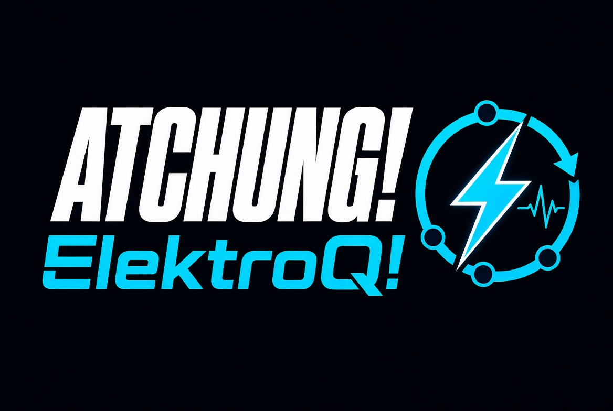

<p align="center">
  
</p>

# Atchung: ElectroQ!

**Attention! Something happened — here, or across the wire.**

Part of the [VexelRay](https://sibarum.github.io/) stack. Building an application on it? Start at the [developer guide](https://sibarum.github.io/vexelray-framework/developers/).

Two complementary messaging layers for the JVM and GraalVM native-image, under one roof:

- **Atchung!** (`atchung-core`) — a realtime, multithreaded **in-VM broadcast/subscribe event bus**.
  Publish an event on a topic; every subscriber reacts. Zero-copy, zero-dependency, no reflection.
- **elektro-Q** (`elektroq/`) — a reflection-free **message-passing stack** that moves typed messages
  **between processes and across the network**. Codecs are generated at compile time from annotated
  records, so the whole stack compiles to a native binary with zero reachability configuration.
- **The bridge** (`atchung-elektroq`) — glue that lets a local `Topic` cross the wire. Author your
  events once as `@Message` records; the bus fans them out in-process and elektro-Q carries them out.

The design principle across both: **the fast in-VM path never pays for the network.** Cross-process
delivery is opt-in and lives entirely in elektro-Q and the bridge — the bus core stays pure.

## Modules

| Module | What it provides |
|---|---|
| `atchung-core` | The event bus: `Topic` (state or edge), `Atchung`, inline/async/pumped delivery, `Backpressure`, pause/resume, the `Tick` that drains many components' inboxes in one order, the `State<T>` synchronization primitive, and the `Ledger<T>` its owner changes by declared steps. Pure Java, no dependencies. |
| `atchung-probe` | The stack-wide profiling seam: `Probe`, `Lane`, spans, counters and a resource ledger. Off unless asked, free when off, and dependency-free so any layer can take it without taking the bus. The trace is aligned text for a person watching a run, or a correlation CSV (`probe.format=csv`) for a program reading one afterwards — `CsvView` reads that file back and hunts it for stalls. See [`docs/probe.md`](docs/probe.md). |
| `atchung-elektroq` | `ElektroBridge` — wires an `Atchung` bus to an elektro-Q `Conduit`, both directions, with loop prevention. |
| `elektroq/` | The cross-process stack (own aggregator; coordinates `sibarum.elektro.queue:*`). See [`elektroq/README.md`](elektroq/README.md) for the full tutorial. Modules: `elektroq-core`, `elektroq-codegen`, `elektroq-transport-tcp`, `elektroq-transport-uds`, `elektroq-transport-local`, `elektroq-netcode`, `elektroq-example`. |

## Which layer do I want?

- **One process, many components** (input, graphics, GUI, workers meeting on a bus) → **Atchung!**.
  See the model, delivery modes, and `State<T>` below.
- **Two processes or two machines** exchanging typed messages, with request/reply and schema
  versioning → **elektro-Q** directly ([`elektroq/README.md`](elektroq/README.md)).
- **A local bus whose selected topics should also reach a remote peer** → keep publishing on the bus
  and add an **`ElektroBridge`**.

## Atchung! in one screen

```java
Atchung bus = Atchung.create();                 // or Atchung.global()
Topic<InputEvent> INPUT = Topic.of("input", InputEvent.class);

bus.subscribe(INPUT, e -> ...);                  // inline — publisher's thread, lowest latency
bus.subscribeAsync(INPUT, e -> ..., workerPool); // async — your executor
Pump ui = bus.pump();                            // pumped — drain on YOUR thread, once per frame
ui.subscribe(INPUT, e -> ..., 256, Backpressure.DROP_OLDEST);

bus.publish(INPUT, event);                       // non-blocking; fans out to all three
ui.drain();                                      // deliver queued events on the render thread
```

Publishing never blocks (save a `BLOCK` mailbox); a full pumped mailbox is resolved by
`Backpressure` — `DROP_OLDEST`, `DROP_NEWEST`, `COALESCE_LATEST`, `BLOCK`, or `FAIL`, which stops the
process through the `Fatal` policy rather than shed an event a subscription said it would rather stop
than lose. A pumped mailbox may also take a `Fold` and hold *cells* rather than events: a write
supersedes whatever is queued for the same cell, while an event naming no cell is an edge and queues
on its own. Any `Subscription` can `pause()`/`resume()` (lossy — events during a pause are dropped,
not buffered).

Each of `Pump.subscribe`'s forms has a twin taking a leading `String mailbox` — `ui.subscribe("app.Ui#onInput",
INPUT, e -> ..., 256)` — which names the mailbox for the probe: a named mailbox also writes `enqueue`,
`deliver` and `drop` rows, so a trace says which mailbox a message reached (see
[`docs/probe.md`](docs/probe.md#mailbox-rows)). Delivery is the same either way.

**Events vs. state.** Events answer *"what happened."* `State<T>` answers *"what is true now"* — one
producer commits declared mutations, consumers read coherent immutable versions (lock-free), react
per version, or block until a newer one exists, with bounded history. The version number and named
commit commands are the replication hooks the bridge builds on.

## Many components, one order: the tick

A `Pump` drains one consumer. A `Tick` drains a set of them that must agree on order: each component has an
`Inbox` holding every topic it subscribes to in one queue, and a run delivers to all of them in **rounds** until
nothing is left or a deadline passes.

```java
Topic<Title> TITLE = Topic.state("tab.title", Title.class, Title::id); // what is true now: last write per key wins
Topic<Save>  SAVE  = Topic.edge("editor.save", Save.class);            // what happened: every one, in order

Tick tick = bus.tick(loop::wake);                // the hook runs when a message arrives from outside a tick
Inbox editor = tick.inbox("editor");
Sender<Title> retitle = editor.sender(TITLE);    // a send inside a delivery belongs to the round
editor.subscribe(SAVE, s -> retitle.send(new Title(s.id(), s.name())), 64);

tick.run(deadline);                              // on the thread that owns the tick, once per frame or so
```

- **Arrival.** A message published from outside a tick is staged and enters at the start of the next one, never
  in the middle.
- **Rounds.** What a component sends during a round reaches other inboxes in the next round, so it is delivered in
  the same tick. At the end of a round, outboxes are emptied in the order the inboxes were made. That makes the
  order the same whether lanes (`Tick.Lanes`) run a round on one thread or on several.
- **State and edges.** A topic declares its kind. A state message replaces the queued write to its key; an edge
  is never dropped, and an edge mailbox that overflows is a fault, as `FAIL` is. Two declarations of one channel
  that disagree about its kind are refused.
- **Deadline and loops.** The deadline is checked between rounds; what is left carries over, in order, ahead of new
  arrivals. A chain of sends longer than the tick's hop limit is a `TickLoop` fault, counted per message so that a
  deadline cannot hide it.
- **Outside the tick.** A `Pump` or an inline subscriber receives a tick's sends when the tick ends, together and
  in order.

vexelray-framework builds its components on this. Its `docs/threading.md` §0 and §5 are the rules, and
`TickTest` holds each one.

**A state its owner changes: the ledger.** A `Ledger<T>` is a `State<T>` owned by one inbox and changed only by
the steps declared on it. A change is a message, a step with its arguments, and the owner runs it:

```java
Ledger.Builder<Notes> b = Ledger.of(Notes.EMPTY);
Step<Notes, String> add = b.step("add", (notes, line, out) -> {
    out.send(ADDED, new Added(line));            // leaves when the round ends, and only if the step returns
    return notes.with(line);
});
Ledger<Notes> notes = b.build(tick.inbox("notes"), "notes.tx", 64);

bus.publish(notes.topic(), add.with("milk"));    // or a Sender for notes.topic(), from another component
notes.state().value();                           // reads are snapshots, from any thread
```

Transactions run one at a time on the owner's lane, each on the state the last one left. A step that throws
commits nothing and its sends are taken back. A sender that does not know the ledger, such as a job replying or a
view reporting, publishes a plain message, and the ledger says which step it runs:
`b.on(FILE_READ, opened)`, beside its other deliveries and in order with them. `LedgerTest` holds this, and
vexelray-framework's `docs/plans/chains.md` is what it is for.

**From a cause to its outcome: the chain.** A `Chain` is steps on several ledgers, written once, where what one step
gives as its outcome (`out.result`) is the next one's arguments, if it is the type the next link takes:

```java
Chain<View, Click> close = Chain.start("close", view, closeClicked)     // gives CloseAsked
        .then(CloseAsked.class,   editor,  closeRequested)              // gives PromptToSave, or Closed (the end)
        .then(PromptToSave.class, dialogs, askSave)                     // out.hold(): waits for the person
        .then(Save.class,         editor,  saveAndClose)                // after a later step's out.resume(...)
        .or(DontSave.class,       editor,  discardAndClose)             // Cancel: no alternative takes it, the end
        .then(Closed.class,       view,    closed)                      // both branches join here
        .build();
bus.publish(close.topic(), close.with(click));
```

A link's alternatives are tried in the order they were declared, as `catch` clauses are, and one an earlier
alternative already covers is refused when the chain is built. Going on is a send in the step's outbox, so a step
that throws takes it back too. A step never waits: it holds the
run and keeps the `Chain.Resume` in its state, and a later step resumes it. Every run has one id (`out.run()`) through
all its steps. `ChainTest` holds this, on the plan's witness, closing a dirty document.

**Undo by snapshot.** A ledger built `.undoable(undo)` records each change it commits in an `Undo` history, grouped
by the chain run that made it (a step that resumed a held run is part of it; a change in no run is a group of its
own). `undo.undo()` and `undo.redo()` put a whole group back or forward, on every ledger it reached, by restoring
the values before and after: nobody writes a reverse. They run on the tick's coordinator between rounds, when no step
is running, so a group is restored on all its ledgers or on none. A ledger that no longer holds what the group left
(compared with `equals`) makes it a conflict, and nothing moves. Each request's outcome is said on
`undo.outcomes()`. `UndoTest` holds this.

## Crossing the wire with the bridge

Declare the event as an elektro-Q `@Message` record (the codec is generated), then bridge its topic:

```java
Conduit conduit = ElektroTcp.client("client", "127.0.0.1", 7000, registry);
conduit.start().toCompletableFuture().join();

Topic<Move> MOVE = Topic.of("move", Move.class);   // Move is an @Message record

ElektroBridge bridge = new ElektroBridge(bus, conduit)
        .bridge(MOVE, MoveCodec.TYPE);              // both directions

bus.publish(MOVE, new Move(dx, dy));               // fans out locally AND goes over the wire
```

`bridge(...)` wires both directions; `outbound(...)`/`inbound(...)` pick one. Re-published inbound
messages are not echoed back to the wire, and a bridge does not relay between peers — a message from
one peer is delivered locally, not fanned back to the others.

## Requirements

- **JDK 25+** (enforced by `maven-enforcer-plugin`). A **GraalVM** JDK only for native builds.
- **Maven 3.9+**.
- `atchung-core` has no runtime dependencies and is native-image clean; elektro-Q adds no runtime
  dependencies either (its codec generator is compile-time only).

## Build

```bash
mvn verify     # compile + all tests across every module
mvn install    # + install 1.0-SNAPSHOT into your local repo
```

elektro-Q also ships a `native` profile for its self-verifying binary — see
[`elektroq/README.md`](elektroq/README.md).
